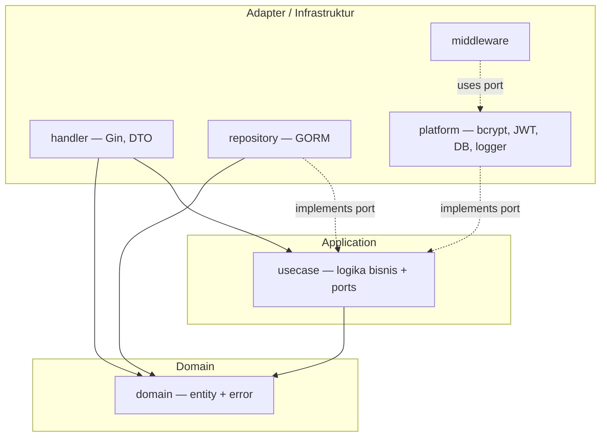
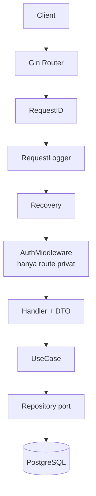
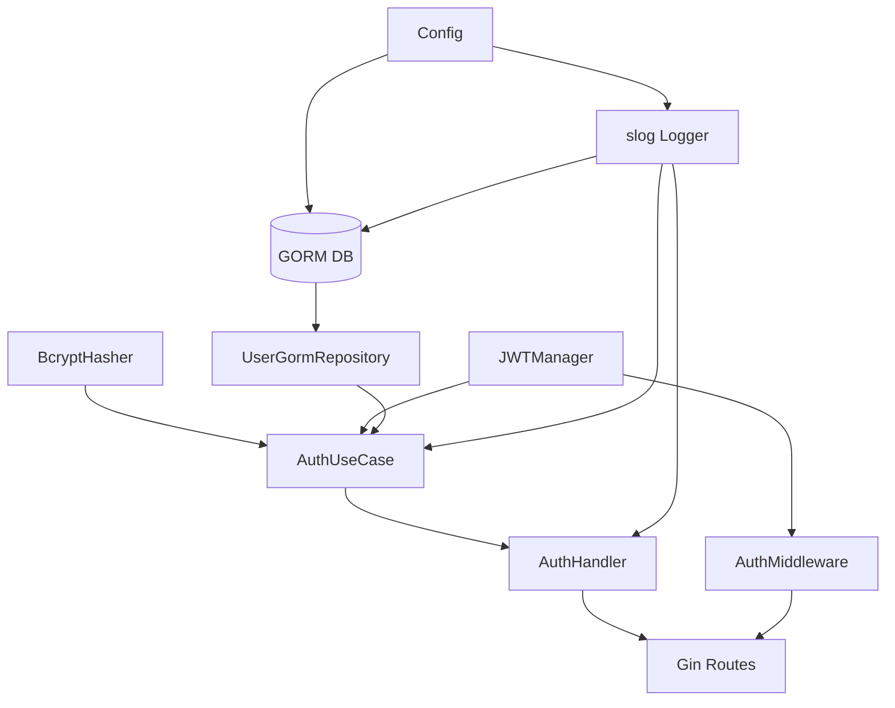
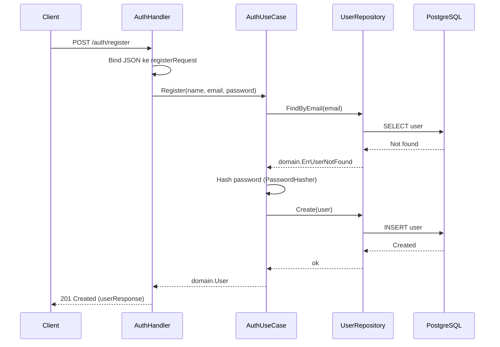
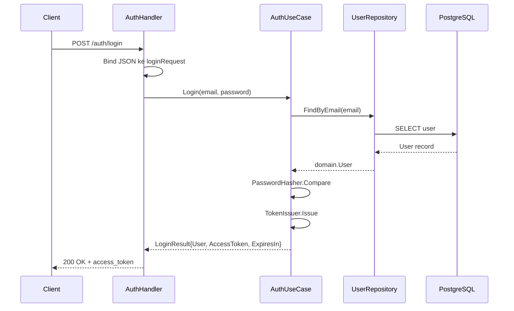

# TruSS — Architecture

## 1. Architectural Style

Backend TruSS menggunakan **Clean Architecture** dalam bentuk **modular monolith**. Kode dibagi per modul fitur (`internal/modules/<fitur>`), dan setiap modul dibagi menjadi lapisan `domain`, `usecase`, `repository`, dan `handler`.

Aturan utamanya adalah **Dependency Rule**: dependensi source code hanya boleh menunjuk ke dalam.



Konsekuensinya:
- `domain` tidak mengimpor package lain dari proyek maupun framework (Gin, GORM, JWT, bcrypt).
- `usecase` hanya mengimpor `domain`. Kebutuhan terhadap dunia luar dinyatakan sebagai **interface (port)**.
- `repository`, `platform`, dan `handler` adalah **adapter** yang mengimplementasikan atau memanggil port tersebut.
- Hanya `cmd/api/main.go` (composition root) yang mengenal semua lapisan.

## 2. Project Structure

```text
cmd/api/main.go                    Composition root (wiring dependency)
internal/
├── config/config.go               Membaca environment variable sekali
├── middleware/
│   ├── auth_middleware.go         Validasi Bearer token (interface TokenValidator)
│   ├── request_id.go              X-Request-ID per request
│   └── logging.go                 Access log + panic recovery
├── platform/
│   ├── database/                  Koneksi PostgreSQL + adapter log GORM → slog
│   ├── logger/                    Pembuat logger terstruktur (slog)
│   └── security/                  BcryptHasher, JWTManager
├── modules/
│   ├── auth/
│   │   ├── domain/                Entity User + error domain
│   │   ├── usecase/               Register, Login, GetProfile + ports
│   │   ├── repository/            UserGormRepository + userRecord
│   │   └── handler/               Gin handler, DTO, RegisterRoutes
│   ├── workspaces/
│   │   ├── domain/                Workspace, Member, Role, matriks izin peran + error domain
│   │   ├── usecase/               Workspace (Create/List/Get) dan Member (Add/List/Remove) + ports
│   │   ├── repository/            WorkspaceGormRepository (transaksi workspace + Owner, anggota),
│   │   │                          UserDirectoryGorm (cari user by email, baca-saja)
│   │   └── handler/               WorkspaceHandler, MemberHandler, DTO, helper error bersama
│   ├── projects/
│   │   ├── domain/                Project, Member, Status, peran, matriks izin (Access)
│   │   ├── usecase/               Project (CRUD) dan Member (Add/List/Remove) + ports
│   │   ├── repository/            ProjectGormRepository (project, akses, anggota)
│   │   └── handler/               ProjectHandler, MemberHandler, DTO, helper error bersama
│   └── tasks/
│       ├── domain/                Task, Status, Priority, Activity + diff, Comment, matriks izin
│       ├── usecase/               Task (CRUD + Activities) dan Comment (CRUD) + ports
│       ├── repository/            TaskGormRepository (task + aktivitas, filter, kunci, komentar)
│       └── handler/               TaskHandler, CommentHandler, DTO (optString: null vs tidak dikirim)
├── testutil/pgtest/               Helper integration test (schema sementara + semua migration)
└── model/                         (Legacy) model GORM modul lain, belum direfactor
```

## 3. Request Flow



Endpoint publik (register, login) tidak melewati `AuthMiddleware`. Endpoint terlindungi harus melewati middleware JWT sebelum mencapai handler.

## 4. Layer Responsibilities

### Domain (`modules/<fitur>/domain`)
- Entity murni (tanpa tag `gorm` atau `json`).
- Error bisnis: `ErrInvalidInput`, `ErrEmailAlreadyUsed`, `ErrInvalidCredentials`, `ErrUserNotFound`.
- Tidak mengimpor framework apa pun.

### Use Case (`modules/<fitur>/usecase`)
- Menjalankan aturan bisnis: normalisasi input, cek email unik, batas password 72 karakter, hashing, penerbitan token.
- Mendefinisikan port di `ports.go`: `UserRepository`, `PasswordHasher`, `TokenIssuer`.
- Mencatat peristiwa bisnis (user terdaftar, login berhasil/gagal) lewat `*slog.Logger`.
- Tidak mengenal HTTP, GORM, bcrypt, atau JWT.

### Repository (`modules/<fitur>/repository`)
- Satu-satunya tempat yang mengenal GORM, nama tabel, dan kolom.
- Memakai model persistence (`userRecord`) yang dipetakan ke entity domain.
- Menerjemahkan error GORM menjadi error domain (`ErrRecordNotFound` → `ErrUserNotFound`, `ErrDuplicatedKey` → `ErrEmailAlreadyUsed`).
- Tidak mencatat log dan tidak menentukan status HTTP.

### Handler (`modules/<fitur>/handler`)
- Satu-satunya tempat yang mengenal Gin dan HTTP.
- Bind JSON ke DTO request, memanggil use case, memetakan hasil ke DTO response.
- Memetakan error domain ke status HTTP; error tak terduga dicatat di log dan client menerima pesan generik.
- Entity domain tidak pernah dikirim langsung ke client.

### Middleware
- `AuthMiddleware` bergantung pada interface `TokenValidator`, bukan pada JWT.
- `RequestID`, `RequestLogger`, dan `Recovery` menangani observability lintas endpoint.

### Platform
- Implementasi teknis: bcrypt, JWT (HS256), koneksi PostgreSQL, logger.

### Config
- Membaca environment variable satu kali dan memvalidasi nilai wajib (`JWT_SECRET`).
- Nilai konfigurasi disuntikkan ke komponen lain; tidak ada package yang memanggil `os.Getenv` sendiri.

## 5. Dependency Wiring

`cmd/api/main.go` merakit dependency dari bawah ke atas:



## 6. Authentication Flow

### Register



### Login



Penerbitan token dilakukan oleh use case melalui port `TokenIssuer`; handler tidak lagi memanggil helper JWT.

## 7. Error Handling

- Repository menerjemahkan error teknis menjadi error domain, dan mengembalikan error lain apa adanya.
- Use case mengembalikan error domain.
- Handler memetakan error domain ke HTTP:

| Error domain | HTTP |
|---|---|
| `ErrInvalidInput` | 400 |
| `ErrInvalidCredentials` | 401 |
| `ErrUserNotFound` | 404 |
| `ErrEmailAlreadyUsed` | 409 |
| lainnya | 500 (pesan generik, detail dicatat di log) |

## 8. Logging

Logging memakai `log/slog` (library standar Go) dan disuntikkan sebagai `*slog.Logger`.

| Lapisan | Apa yang dicatat |
|---|---|
| Middleware `RequestLogger` | Satu baris per request: `request_id`, method, path (template route), status, latency, client IP, `user_id` bila ada |
| Middleware `Recovery` | Panic beserta stack trace (hanya di log, bukan ke client) |
| Use case | Peristiwa bisnis: user terdaftar, login berhasil, login gagal |
| Handler | Error tak terduga (500) dengan `request_id` |
| Platform/database | Error query dan query lambat (> 200 ms); SQL dicatat tanpa nilai parameter |
| Repository | Tidak mencatat; hanya mengembalikan error (mencegah log ganda) |

Level log: `info` untuk request sukses, `warn` untuk 4xx, `error` untuk 5xx. Format: teks di `development`, JSON di `production`.

Yang **tidak boleh** dicatat: password, password hash, token JWT, header `Authorization`, body request, dan query string.

## 9. Authorization Pattern

Otorisasi dilakukan di **use case**, bukan di handler maupun repository. Contoh pada modul workspaces:

1. Use case mencari peran pemanggil (`FindMemberRole`). Non-anggota menghasilkan `ErrWorkspaceNotFound` (HTTP 404) sehingga keberadaan workspace tidak bocor.
2. Aturan peran ditulis sebagai fungsi murni di `domain` (`CanAddMember`, `CheckRemoveMember`) dan diuji dengan matriks lengkap. Anggota tanpa izin menghasilkan `ErrForbidden` (HTTP 403).
3. Baru setelah itu data dibaca atau diubah.

Antar-modul, ketergantungan dinyatakan sebagai port. Modul workspaces membutuhkan pencarian user berdasarkan email, sehingga ia mendefinisikan port `UserDirectory`; adapter `UserDirectoryGorm` membacanya dari tabel `users` tanpa mengimpor modul auth.

Modul projects memakai pola yang sama: otorisasinya bergantung pada peran workspace, tetapi ia tidak mengimpor modul workspaces. Ia mendefinisikan tipe `WorkspaceRole` sendiri, dan repository-nya membaca tabel `workspace_members` secara baca-saja. Aturan akses (`Access.CanView/CanUpdate/CanDelete`, `CanCreateProject`) adalah fungsi murni di domain projects.

### Konsistensi lintas modul

Dua invarian melintasi batas modul dan dijaga di database dalam satu transaksi, bukan di memori:

- **Keluar dari workspace membersihkan keanggotaan project.** `RemoveMember` (repository workspaces) mengunci baris keanggotaan (`FOR UPDATE`), menolak bila user masih Owner project di workspace itu (`ErrMemberOwnsProjects`, 409), lalu menghapus keanggotaan project dan workspace sekaligus.
- **Pembuat project harus masih anggota workspace.** `CreateWithOwner` (repository projects) mengunci baris keanggotaan workspace pembuat (`FOR SHARE`). Karena kedua kunci saling meniadakan, user tidak bisa menjadi Owner project baru di tengah proses dikeluarkan.
- **Anggota project harus anggota workspace.** `AddMember` (repository projects) mengunci keanggotaan workspace target dengan cara yang sama, sehingga seseorang tidak bisa ditambahkan ke project tepat saat ia keluar dari workspace.
- **Assignee task harus anggota project.** Repository tasks mengunci keanggotaan project assignee (`FOR SHARE`) saat menugaskan. Sebaliknya, `RemoveMember` di projects dan workspaces melepas assignee task (`assignee_id = NULL`) dan menulis aktivitas `assignee_changed` dalam transaksi yang sama, lewat satu pernyataan `WITH ... UPDATE ... RETURNING` + `INSERT ... SELECT`.

### Pola update dengan kunci baris (tasks)

`TaskRepository.Update(ctx, id, fn)` mengunci baris task (`SELECT ... FOR UPDATE`), lalu memanggil `fn` dari use case dengan data terkunci. Use case memeriksa ulang izin (assignee/pembuat bisa berubah sejak dibaca), menerapkan patch, dan menghitung aktivitas dari selisih data terkunci. Repository lalu menyimpan task dan aktivitas dalam transaksi yang sama. Dengan pola ini aturan bisnis tetap di use case, sementara repository hanya mengurus transaksi dan penguncian.

Repository workspaces sengaja menyentuh tabel `projects`/`project_members` untuk pembersihan ini, agar atomik tanpa koordinasi transaksi lintas modul.

## 10. Design Considerations

- Tambahkan fitur baru sebagai modul baru di `internal/modules/<fitur>` dengan empat lapisan yang sama.
- Jangan mengimpor `gorm`, `gin`, atau `jwt` dari `domain` dan `usecase`.
- Database unique constraint tetap menjadi proteksi akhir terhadap race condition email duplikat.
- Tambahkan pemeriksaan otorisasi (membership/role) di use case sebelum membuka data workspace, project, atau task.
- `internal/model` adalah kode lama untuk modul yang belum direfactor; model tersebut dipindahkan ke modul masing-masing saat fiturnya dikerjakan.
