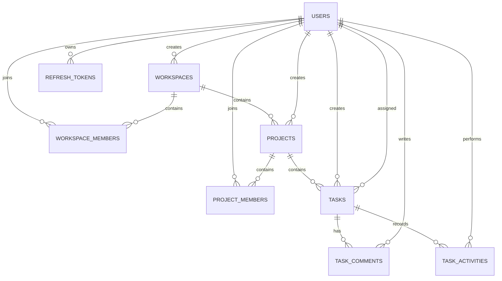

# TruSS — Database Design

## 1. Database

- DBMS: PostgreSQL.
- ORM: GORM.
- Primary key convention: `internal_id` untuk entitas utama.
- Identifier: UUID.
- Timestamp: disarankan menggunakan `TIMESTAMPTZ`.
- Soft delete: model `User` menggunakan `gorm.DeletedAt`; tabel terkait harus memiliki kolom `deleted_at` jika fitur ini digunakan.

## 2. Current User Model

Dengan Clean Architecture, "user" memiliki tiga representasi:

| Representasi | Lokasi | Fungsi |
|---|---|---|
| `domain.User` | `modules/auth/domain` | Entity bisnis, tanpa tag `gorm`/`json` |
| `userRecord` | `modules/auth/repository` | Model persistence (tabel `users`), tag GORM |
| `userResponse` | `modules/auth/handler` | DTO respons API |

Repository memetakan `userRecord` ke `domain.User`. `internal/model/users.go` masih ada karena model workspace/project/task lama mereferensikannya; model itu dipindahkan saat modul terkait dikerjakan.

Field pada tabel `users`:

| Field | Type (logical) | Constraint / Notes |
|---|---|---|
| `internal_id` | UUID | Primary key |
| `name` | VARCHAR(100) | Not null |
| `email` | VARCHAR(255) | Unique, not null |
| `password_hash` | VARCHAR(255) | Not null; tidak dikirim dalam JSON |
| `created_at` | Timestamp | Not null |
| `updated_at` | Timestamp | Not null |
| `deleted_at` | Timestamp nullable | Digunakan GORM soft delete |

Pastikan tipe dan constraint migration sama dengan model GORM yang digunakan.

## 3. Planned Domain Tables

Tabel berikut berasal dari rancangan domain TruSS yang telah dibahas. Detail final harus disesuaikan dengan migration dan ERD aktual.

### users

Menyimpan akun pengguna.

### workspaces

Menyimpan ruang kerja. Rancangan field:
- `internal_id`
- `name`
- `description`
- `created_by` → `users.internal_id`
- `created_at`
- `updated_at`

### workspace_members

Menghubungkan user dengan workspace.
- `workspace_id` → `workspaces.internal_id`
- `user_id` → `users.internal_id`
- `role`
- `joined_at`

Rancangan primary key: gabungan `(workspace_id, user_id)`.

### projects

Menyimpan project di dalam workspace.
- `internal_id`
- `workspace_id` → `workspaces.internal_id`
- `name`
- `description`
- `status`
- `created_by` → `users.internal_id`
- `created_at`
- `updated_at`

### project_members

Menghubungkan user dengan project.
- `project_id` → `projects.internal_id`
- `user_id` → `users.internal_id`
- `role`
- `joined_at`

Rancangan primary key: gabungan `(project_id, user_id)`.

### tasks

Menyimpan pekerjaan dalam project.
- `internal_id`
- `project_id` → `projects.internal_id`
- `title`
- `description`
- `status`
- `priority`
- `assignee_id` → `users.internal_id` (nullable)
- `created_by` → `users.internal_id`
- `due_date`
- `created_at`
- `updated_at`

### task_comments

Menyimpan komentar task.
- `internal_id`
- `task_id` → `tasks.internal_id`
- `user_id` → `users.internal_id`
- `content`
- `created_at`
- `updated_at`

### task_activities

Menyimpan riwayat aktivitas task.
- `internal_id`
- `task_id` → `tasks.internal_id`
- `actor_id` → `users.internal_id`
- `activity_type`
- `old_value` JSONB
- `new_value` JSONB
- `created_at`

### refresh_tokens

Menyimpan refresh token (migration 11). Nilai asli token tidak pernah disimpan.
- `internal_id` UUID, primary key
- `user_id` → `users.internal_id` (`ON DELETE CASCADE`)
- `family_id` UUID: sama untuk semua token hasil rotasi dari satu login
- `token_hash` CHAR(64), unik: SHA-256 heksadesimal dari token
- `expires_at` TIMESTAMPTZ
- `revoked_at` TIMESTAMPTZ nullable: terisi bila token sudah dirotasi atau dicabut
- `created_at`

Indeks pada `user_id` dan `family_id`.

## 4. Relationship Overview



## 5. Database Integrity Rules

- Email harus unik pada database, bukan hanya diperiksa di use case. Pelanggaran unique constraint diterjemahkan repository menjadi `domain.ErrEmailAlreadyUsed` (koneksi memakai `TranslateError: true`).
- Log query tidak memuat nilai parameter, sehingga data sensitif tidak tercatat.
- Semua foreign key harus mengarah ke kolom primary key yang benar (`internal_id` untuk entitas utama).
- `assignee_id` boleh `NULL` jika task belum ditugaskan.
- Membership sebaiknya mencegah pasangan user dan workspace/project yang sama tercatat lebih dari sekali.
- Tentukan kebijakan `ON DELETE` secara eksplisit untuk setiap foreign key.
- Gunakan transaksi ketika satu operasi bisnis mengubah beberapa tabel.
- Jangan menganggap model GORM otomatis membuat skema jika proyek menggunakan SQL migrations.

## 6. Migration Management

Jika proyek menggunakan `golang-migrate`, simpan pasangan file migration:

```text
migrations/
├── 000001_create_users.up.sql
├── 000001_create_users.down.sql
├── 000002_create_workspaces.up.sql
├── 000002_create_workspaces.down.sql
└── ...
```

Jangan menjalankan `AutoMigrate` sebagai pengganti migration SQL tanpa keputusan eksplisit. Migration yang telah diterapkan di environment bersama harus dikelola dengan hati-hati.

## 7. Schema Verification

Hasil pencocokan migration `000001`–`000008` dengan model GORM (`internal/model`) dan PRD:

| Temuan | Tindakan |
|---|---|
| Tabel pendukung dibuat tunggal (`workspace_member`, `project_member`, `task_comment`, `task_activity`), sedangkan GORM, PRD, dan dokumen ini memakai jamak | Migration `000009` me-rename ke `workspace_members`, `project_members`, `task_comments`, `task_activities` (beserta PK dan index) |
| `project_member.role` hanya `admin`/`member`, padahal PRD FR-04 membutuhkan Owner project | Migration `000010` mengizinkan `owner`, `admin`, `member` |
| `tasks.title` `VARCHAR(100)`, PRD FR-05 menyebut maks. 200 karakter | Migration `000010` melebarkan ke `VARCHAR(200)`; model `Task.Title` disesuaikan |

Migration `000009` dan `000010` harus diterapkan: `migrate -path ./migrations -database "$env:DATABASE_URL" up`.

Checklist:

- [x] Semua primary key sesuai konvensi `internal_id` (kecuali tabel keanggotaan yang memakai PK gabungan).
- [x] Semua foreign key mengarah ke `internal_id` yang benar, dengan kebijakan `ON DELETE` eksplisit.
- [x] Kolom `deleted_at` tersedia untuk `users` (satu-satunya model dengan soft delete).
- [x] Unique constraint email tersedia (teruji lewat integration test repository).
- [x] Tipe UUID konsisten antara Go dan PostgreSQL.
- [x] Timestamp memakai `TIMESTAMPTZ`.
- [x] Migration up dan down telah ditinjau.
- [x] Index tersedia untuk foreign key dan pencarian utama (`user_id`, `workspace_id`, `project_id`, `assignee_id`, `(project_id, status)`, `(task_id, created_at)`).
- [ ] Index untuk dashboard task terlambat (`tasks(project_id, due_date)`), tambahkan saat modul dashboard dikerjakan.
- [ ] Email pada akun yang di-soft-delete tidak dapat didaftarkan ulang (unique constraint mengabaikan `deleted_at`); putuskan apakah perlu partial unique index.